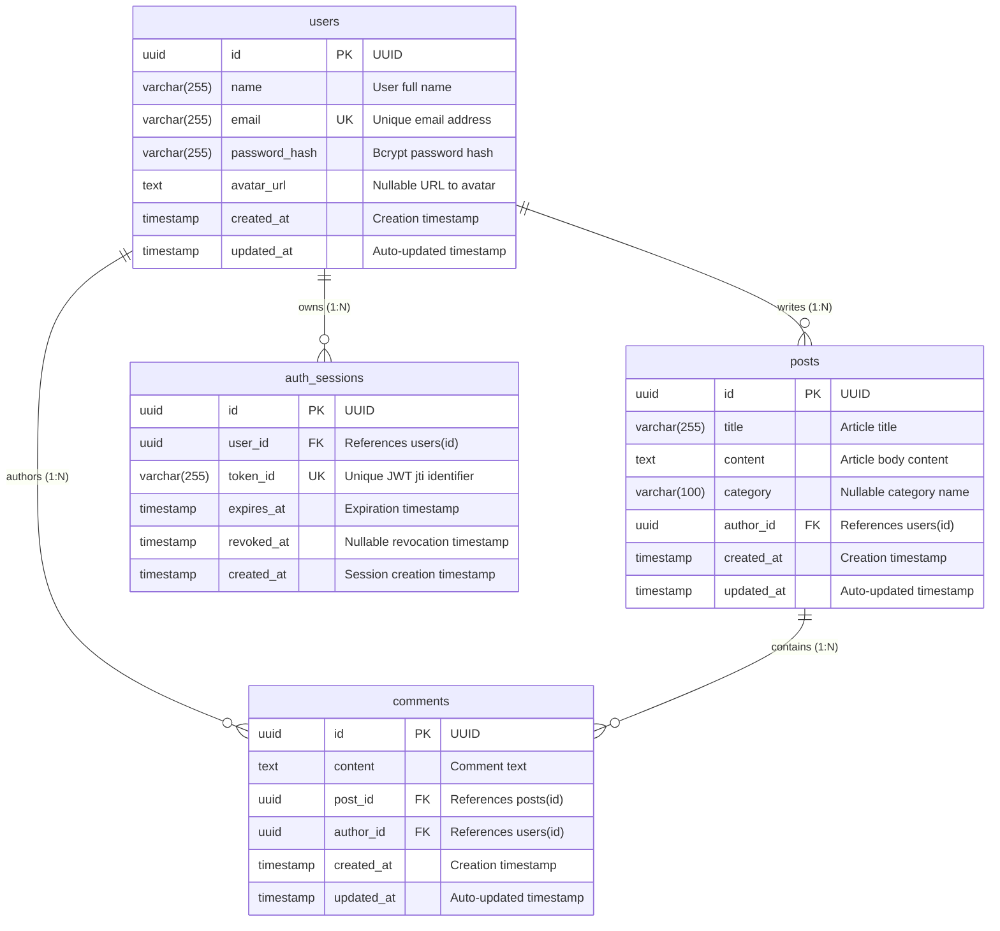

# Talent Growth Blog Platform — Database ERD & Schema Design

Dokumen ini menjelaskan rancangan skema database relasional, relasi antarmodel, batasan (constraints), indeks, serta kebijakan referensial untuk **Talent Growth Blog Platform** menggunakan **PostgreSQL** dan **Prisma ORM**.

---

## 1. Diagram Entity Relationship (ERD)

Diagram berikut merepresentasikan empat tabel inti dalam platform: `users`, `posts`, `comments`, dan `auth_sessions`.



---

## 2. Struktur Tabel & Kamus Data

### A. Tabel `users` (Model: `User`)
Menyimpan data identitas akun pengguna.

| Field | Tipe Data (PostgreSQL) | Nullable | Default | Keterangan |
| :--- | :--- | :--- | :--- | :--- |
| `id` | `UUID` | Tidak | `gen_random_uuid()` | Primary Key |
| `name` | `VARCHAR(255)` | Tidak | - | Nama lengkap pengguna |
| `email` | `VARCHAR(255)` | Tidak | - | Email unik untuk login |
| `password_hash` | `VARCHAR(255)` | Tidak | - | Hash password (misal: bcrypt) |
| `avatar_url` | `TEXT` | Ya | `NULL` | URL avatar pengguna |
| `created_at` | `TIMESTAMP(3)` | Tidak | `CURRENT_TIMESTAMP` | Waktu akun dibuat |
| `updated_at` | `TIMESTAMP(3)` | Tidak | Auto-update | Waktu akun terakhir diperbarui |

### B. Tabel `posts` (Model: `Post`)
Menyimpan artikel atau konten blog yang dipublikasikan oleh pengguna.

| Field | Tipe Data (PostgreSQL) | Nullable | Default | Keterangan |
| :--- | :--- | :--- | :--- | :--- |
| `id` | `UUID` | Tidak | `gen_random_uuid()` | Primary Key |
| `title` | `VARCHAR(255)` | Tidak | - | Judul artikel |
| `content` | `TEXT` | Tidak | - | Isi lengkap artikel blog |
| `category` | `VARCHAR(100)` | Ya | `NULL` | Kategori artikel (opsional) |
| `author_id` | `UUID` | Tidak | - | Foreign Key ke `users(id)` |
| `created_at` | `TIMESTAMP(3)` | Tidak | `CURRENT_TIMESTAMP` | Waktu post dibuat |
| `updated_at` | `TIMESTAMP(3)` | Tidak | Auto-update | Waktu post terakhir diperbarui |

### C. Tabel `comments` (Model: `Comment`)
Menyimpan komentar pengguna pada sebuah artikel blog.

| Field | Tipe Data (PostgreSQL) | Nullable | Default | Keterangan |
| :--- | :--- | :--- | :--- | :--- |
| `id` | `UUID` | Tidak | `gen_random_uuid()` | Primary Key |
| `content` | `TEXT` | Tidak | - | Isi komentar |
| `post_id` | `UUID` | Tidak | - | Foreign Key ke `posts(id)` |
| `author_id` | `UUID` | Tidak | - | Foreign Key ke `users(id)` |
| `created_at` | `TIMESTAMP(3)` | Tidak | `CURRENT_TIMESTAMP` | Waktu komentar dibuat |
| `updated_at` | `TIMESTAMP(3)` | Tidak | Auto-update | Waktu komentar diperbarui |

### D. Tabel `auth_sessions` (Model: `AuthSession`)
Menyimpan metadata sesi autentikasi dan pencabutan token (logout/revocation).

| Field | Tipe Data (PostgreSQL) | Nullable | Default | Keterangan |
| :--- | :--- | :--- | :--- | :--- |
| `id` | `UUID` | Tidak | `gen_random_uuid()` | Primary Key |
| `user_id` | `UUID` | Tidak | - | Foreign Key ke `users(id)` |
| `token_id` | `VARCHAR(255)` | Tidak | - | Unique JWT identifier (`jti`) |
| `expires_at` | `TIMESTAMP(3)` | Tidak | - | Waktu kedaluwarsa token |
| `revoked_at` | `TIMESTAMP(3)` | Ya | `NULL` | Waktu pencabutan token (logout) |
| `created_at` | `TIMESTAMP(3)` | Tidak | `CURRENT_TIMESTAMP` | Waktu sesi dibuat |

---

## 3. Kardinalitas Relasi

1. **User 1 : N Post (`users.id` -> `posts.author_id`)**
   - Satu pengguna dapat menulis banyak artikel blog.
   - Setiap artikel blog wajib memiliki tepat satu penulis (`author`).
2. **User 1 : N Comment (`users.id` -> `comments.author_id`)**
   - Satu pengguna dapat memberikan banyak komentar di berbagai artikel.
   - Setiap komentar wajib terhubung ke satu pengguna penulis.
3. **Post 1 : N Comment (`posts.id` -> `comments.post_id`)**
   - Satu artikel blog dapat memiliki banyak komentar dari berbagai pengguna.
   - Setiap komentar wajib terhubung ke tepat satu artikel blog.
4. **User 1 : N AuthSession (`users.id` -> `auth_sessions.user_id`)**
   - Satu pengguna dapat memiliki banyak sesi autentikasi aktif (misalnya login dari beberapa perangkat).
   - Setiap sesi terhubung secara eksklusif ke satu akun pengguna.

---

## 4. Batasan (Constraints) & Indeks (Indexes)

### A. Unique Constraints
1. `users(email)`: Mencegah duplikasi pendaftaran email yang sama.
2. `auth_sessions(token_id)`: Menjamin setiap JWT token ID (`jti`) bersifat unik untuk verifikasi status sesi yang cepat dan akurat.

### B. Indexes
Indeks disusun secara strategis berdasarkan kebutuhan query yang sering dijalankan:
1. `posts(author_id, created_at)`:
   - **Tujuan**: Mempercepat pemuatan daftar artikel milik penulis tertentu yang diurutkan berdasarkan tanggal terbaru (misal: halaman profil penulis, dashboard artikel pengguna).
2. `comments(post_id, created_at)`:
   - **Tujuan**: Mempercepat pemuatan daftar komentar di bawah artikel tertentu secara kronologis atau reverse-chronological.
3. `comments(author_id)`:
   - **Tujuan**: Mempercepat pencarian seluruh komentar yang ditulis oleh pengguna tertentu.
4. `auth_sessions(user_id)`:
   - **Tujuan**: Mempercepat operasi pencabutan seluruh sesi milik seorang pengguna (misal: "logout all devices").

---

## 5. Kebijakan Penghapusan Data (Referential Actions)

Kebijakan referential action ditetapkan secara eksplisit pada foreign keys untuk menjaga integritas data relasional:

1. **`posts.author_id` -> `users.id` (`ON DELETE CASCADE`)**:
   - Ketika akun pengguna dihapus, semua artikel blog yang ditulis oleh pengguna tersebut ikut terhapus secara otomatis, mencegah adanya artikel tanpa penulis (*orphan records*).
2. **`comments.post_id` -> `posts.id` (`ON DELETE CASCADE`)**:
   - Ketika artikel blog dihapus, seluruh komentar yang menempel pada artikel tersebut secara otomatis ikut dihapus.
3. **`comments.author_id` -> `users.id` (`ON DELETE CASCADE`)**:
   - Ketika akun pengguna dihapus, seluruh komentar yang pernah dibuat oleh pengguna tersebut ikut terhapus.
4. **`auth_sessions.user_id` -> `users.id` (`ON DELETE CASCADE`)**:
   - Ketika akun pengguna dihapus, semua sesi autentikasi terkait langsung terhapus demi keamanan dan kebersihan database.

---

## 6. Mengapa `AuthSession` Diperlukan untuk Mendukung Logout?

JSON Web Token (JWT) secara desain bersifat *stateless*. Artinya, setelah token ditandatangani dan diberikan ke klien, server tidak perlu menyimpan sesi di memori atau database untuk memverifikasinya. Namun, sifat stateless ini menimbulkan masalah keamanan saat pengguna melakukan **logout**:

1. **Masalah Logout pada JWT Murni**:
   - Tanpa penyimpanan status di server, token yang masih memiliki sisa waktu berlaku tetap valid jika digunakan oleh siapa pun yang memilikinya hingga token kedaluwarsa.
2. **Solusi dengan `AuthSession`**:
   - Setiap kali JWT diterbitkan, server memasukkan klaim unik `jti` (JWT ID) dan mencatat identifier ini ke tabel `auth_sessions` bersama masa berlakunya (`expires_at`).
   - Ketika pengguna menekan tombol **Logout**, server mencatat timestamp pencabutan pada kolom `revoked_at` (atau menghapus baris sesi tersebut).
   - Saat middleware autentikasi menerima request, selain memverifikasi cryptographic signature JWT, sistem memeriksa apakah `token_id` sudah di-revoke. Jika `revoked_at` tidak null, request langsung ditolak (HTTP 401).
3. **Keamanan Tambahan**:
   - Pola ini **TIDAK** menyimpan keseluruhan token JWT (yang berisi signature dan payload sensitif), melainkan hanya `token_id` (`jti`) sebagai referensi pelacakan. Ini menjaga ukuran database tetap efisien dan aman dari risiko pembocoran credential.

---

## 7. Contoh Relasional Sederhana

Skenario alur relasi:

```
[User: "Budi Santoso", id: "u-101", email: "budi@example.com"]
  │
  ├──> writes [Post: "Belajar TypeScript", id: "p-201", authorId: "u-101"]
  │       │
  │       ├──> contains [Comment: "Sangat bermanfaat!", id: "c-301", postId: "p-201", authorId: "u-102"]
  │       └──> contains [Comment: "Terima kasih infonya", id: "c-302", postId: "p-201", authorId: "u-103"]
  │
  └──> owns [AuthSession: id: "s-401", userId: "u-101", tokenId: "jwt-uuid-1", revokedAt: NULL]
```

Penjelasan:
- Pengguna **Budi Santoso** (`u-101`) menulis artikel *"Belajar TypeScript"* (`p-201`).
- Pengguna lain (`u-102` dan `u-103`) menulis komentar pada artikel tersebut (`c-301` dan `c-302`).
- Jika artikel `p-201` dihapus, komentar `c-301` dan `c-302` otomatis ikut terhapus.
- Budi memiliki sesi login aktif `s-401`. Saat Budi logout, kolom `revoked_at` pada `s-401` diisi tanggal saat ini, sehingga token tersebut langsung menjadi tidak valid.
